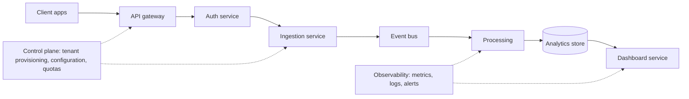

# System Design and Delivery Plan: Multitenant SaaS Analytics Platform

A design and delivery plan for a fictional multitenant analytics platform serving mid-market and enterprise customers.

This is a documentation project, not a codebase. I wrote it to practice the technical program manager's side of system design: framing the system, recording the tradeoffs, naming the risks, and sequencing delivery across teams.

## Architecture at a glance

Every request carries a `tenant_id` from the auth token through the service layer to storage, where row-level security keeps each tenant's data separate.

## Contents

| Document | What it covers |
|---|---|
| [docs/system-overview.md](docs/system-overview.md) | Business goals, core capabilities, scale and availability assumptions, data isolation model |
| [docs/tradeoffs.md](docs/tradeoffs.md) | Key architecture decisions, the alternatives considered, and their consequences |
| [docs/api-contracts.md](docs/api-contracts.md) | Authentication approach and the ingestion API |
| [docs/risks-and-mitigations.md](docs/risks-and-mitigations.md) | Risk register with likelihood, impact, mitigation and owner |
| [plan/roadmap.md](plan/roadmap.md) | Four delivery phases over twelve months |
| [plan/milestones.md](plan/milestones.md) | Six milestones with target weeks and deliverables |
| [plan/dependencies.md](plan/dependencies.md) | Cross-team dependencies |

## Where to start

Read `docs/system-overview.md` first, then `docs/tradeoffs.md` for the decisions behind the design. The `plan` folder shows how the work is sequenced.

## Key decisions

- **Modular monolith first,** with services split out once boundaries and load justify it.
- **Shared database with logical isolation** through row-level security and `tenant_id` scoping, in place of a database per tenant.
- **Managed pub/sub and a managed OLAP service** to start, trading some flexibility for speed and simpler operations.

The reasoning and the alternatives for each are in `docs/tradeoffs.md`.
